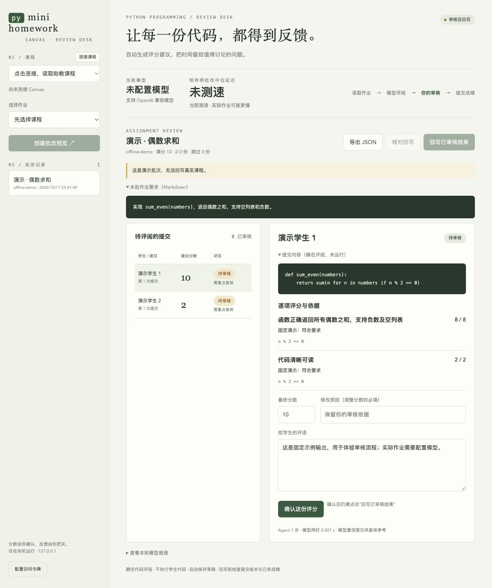
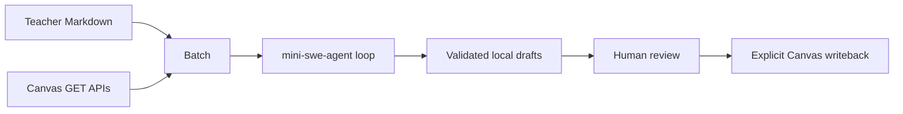

# mini-homework-agent

**A tiny AI homework grading agent for Canvas LMS and Fudan eLearning.** Bring assignment requirements in Markdown, generate scores and feedback, review every result, then explicitly publish approved grades.

[](https://github.com/chaoyuhao/mini-homework-agent/actions/workflows/test.yml)
[](LICENSE)
[](pyproject.toml)

[中文说明 / 复旦助教上手](README.zh-CN.md) · [Website](https://chaoyuhao.github.io/mini-homework-agent/) · [Use from your AI agent](docs/agent-integration.md) · [Fudan eLearning guide](docs/fudan-elearning.md)

mini-homework-agent helps teaching assistants review Python assignments on Canvas-based learning platforms, including **复旦大学 eLearning / elearning.fudan.edu.cn**. It reuses the small **mini-swe-agent** core loop with homework-specific tools. It supports OpenAI-compatible model services and local providers, with no provider lock-in.

中文：面向复旦 eLearning 和 Canvas 的助教 AI 自动判作业、Python 作业批改工具，使用 Markdown 标准，人工审核后回写成绩。

## Why this exists

Homework instructions often live in slides or a separate document, while submissions live in the LMS. Give the agent the actual requirements as a `.md` file. It reads student code as data, drafts rubric-based scores with evidence, and leaves the final judgment to you.

- **Markdown in, reviewed feedback out:** paste requirements or select a local `.md` file.
- **Explicit scoring tables:** parse point allocations from Markdown without inventing weights.
- **A small agent loop:** bounded content reading, Python AST inspection, and grade validation; up to three model calls per submission.
- **Canvas integration:** courses, assignments, uploaded files, drafts, and reviewed grade/comment writeback.
- **Inspect the reasoning trail:** preserve the model/tool trajectory alongside each draft.
- **Try it without credentials:** a fixed offline example demonstrates the entire review UI.



## Quick start

Python 3.10+ on macOS, Linux, or WSL. The current review UI is in Chinese; CLI documentation is available in English and Chinese.

```bash
git clone https://github.com/chaoyuhao/mini-homework-agent.git
cd mini-homework-agent
python3 -m venv .venv
source .venv/bin/activate
pip install -e '.[pdf]'

# Fixed example output: no Canvas account, API key, or network call
mini-homework-agent demo --offline
mini-homework-agent serve
```

Open **http://127.0.0.1:8765**. The offline batch cannot be published to a real course. It demonstrates the interface, not model grading accuracy.

You can also install directly from GitHub:

```bash
pip install 'mini-homework-agent[pdf] @ git+https://github.com/chaoyuhao/mini-homework-agent.git'
```

## Connect Canvas and a model

```bash
# Creates .secrets.json in your current directory with mode 0600
mini-homework-agent init
```

Fill in your own configuration; [.secrets.example.json](.secrets.example.json) documents the shape:

```json
{
  "canvas_base_url": "https://your-school.instructure.com",
  "canvas_token": "YOUR_CANVAS_TOKEN",
  "models": [
    {
      "name": "YOUR_MODEL_NAME",
      "base_url": "https://your-model-provider.example/v1",
      "api_key": "YOUR_MODEL_API_KEY",
      "chat_template_kwargs": {}
    }
  ]
}
```

For Fudan University, use `https://elearning.fudan.edu.cn` as the Canvas base URL. The token inherits your account's existing course permissions; the project does not grant teaching-assistant or administrator access.

Environment variables are supported: `CANVAS_BASE_URL`, `CANVAS_TOKEN`, `MODEL_NAME`, `MODEL_BASE_URL`, `MODEL_API_KEY`. Use `MINI_HOMEWORK_HOME` to choose a configuration/data directory instead of the current directory. Keep credentials out of shell history and public logs.

Start the UI, click **连接课程**, select a course and assignment, and supply its Markdown requirements. Default batches process five submitted, ungraded individual assignments. The agent generates drafts; human review and a separate explicit writeback action are required.

## Write assignment requirements in Markdown

Include the question, input/output behavior, edge cases, submission expectations, and grading rules. See [examples/sum_even.md](examples/sum_even.md).

```markdown
# Sum even numbers
Implement sum_even(numbers). Support negative integers and return 0 for an empty list.

| 评分项 | 分值 | 要求 |
| --- | --- | --- |
| Correctness | 8 | Sum even numbers; handle empty lists and negative values |
| Readability | 2 | Clear function and variable names |
```

English headers `criterion`, `points`, and `description` are supported too. A scoring table's total must match the assignment maximum. Priority: explicit JSON rubric → Markdown table or explicit point list → Canvas rubric → visibly marked provisional criteria. Parenthetical allocations such as `Code quality（20分）` are supported as well. The provisional weights are 60% functional requirements, 25% required edge cases, and 15% readability.

## Grade from the command line

```bash
# Real model, local synthetic file; no Canvas connection
mini-homework-agent grade-local \
  --requirements examples/sum_even.md \
  --submission examples/sum_even.py --points 10

# Inspect the courses and assignments available to your account
mini-homework-agent courses
mini-homework-agent assignments COURSE_ID

# Generate drafts only; --limit 0 processes all eligible submissions
mini-homework-agent grade COURSE_ID ASSIGNMENT_ID \
  --requirements homework.md --limit 5

# After reviewing individual drafts in the UI
mini-homework-agent publish RUN_ID --confirm

# Read-only reconciliation after an ambiguous writeback response
mini-homework-agent reconcile RUN_ID
```

Use `--rubric rubric.json` for an explicit rubric and `--model MODEL_NAME` to select a provider. Already graded submissions are skipped unless you explicitly pass `--include-graded`. `benchmark --rounds 4` compares your configured providers on short synthetic examples and chooses the fastest one passing the basic checks. These checks do not establish course grading accuracy.

## Attachment reading and local OCR

The workflow downloads attachments before grading. Word/PDF text, Python source, notebook cells, and supported archive contents are extracted as data. On macOS, screenshots and embedded document images can be read locally with Apple Vision when Swift command-line tools are installed. On other systems, image OCR can use an already installed Tesseract with Chinese/English language packs; scanned PDFs may require manual review. OCR is optional: unsupported, incomplete, or unreadable material is flagged, never silently given a zero. Legacy `.doc` conversion uses macOS `textutil`; RAR is currently unsupported, and Pages preview extraction is explicitly marked incomplete.

Teacher Markdown may contain explicit leniency, late-percentage, short-feedback, and anomaly-review rules. The program records the raw rubric total separately from policy-adjusted suggestions, applies a recognized late multiplier once, and leaves anomaly results without an automatic final grade. When using a Canvas automatic late policy, check that you are not applying both deductions before publication.

## Small, understandable architecture



The upstream `DefaultAgent` loop is vendored from **mini-swe-agent 2.4.6**, with its MIT license and exact commit recorded in [UPSTREAM.md](grader/_vendor/mini_swe_agent/UPSTREAM.md). Our model and environment adapters replace the coding agent's shell environment. Core runtime dependencies are Jinja2 and Pydantic; PDF extraction additionally uses pypdf.

Read [docs/architecture.md](docs/architecture.md) for the code map and [docs/agent-integration.md](docs/agent-integration.md) for using this tool from another assistant.

## Boundaries and course data

- Static review only: student code and notebooks are **never executed**. No sandboxed test runner, plagiarism detector, or claim of proven correctness is included. Optional local OCR reads screenshots and document images; its output is flagged for review.
- Supported materials: Python, notebook source cells, text/Markdown, HTML, JSON/CSV, bounded ZIPs, DOCX, and PDFs and screenshots where local OCR is available. Missing, unreadable, or truncated material is flagged; it is not silently graded as zero.
- Group assignments, quizzes, nonnumeric grading schemes, and zero-point assignments are not supported by the current grading workflow.
- Original attachments are downloaded into the private `.data/attachments/` folder and can be reopened from the review UI. The model receives requirements, rubric, and extracted submission text, including local OCR output when available. Canvas tokens and student metadata are not sent to it; **personal information written inside student files may still be in the text**.
- Drafts, cached results, and trajectories stay in `.data/`. Exports contain course data. `.gitignore` excludes them, `.secrets.json`, `.env`, and private `api.md` files.
- Before writeback, assignment and submission snapshots are rechecked. Avoid concurrent edits by multiple graders: Canvas's unconditional update endpoint leaves a small check/write race window.
- A timed-out writeback is not blindly retried. The reconciliation command checks for a unique comment marker. Canvas late policies may adjust the final score; the returned platform score is retained.
- Per-item scoring stays in the local record; writeback currently publishes the final numeric score and final feedback, not `rubric_assessment`.

This is a community project, not an official Fudan University or Instructure product. Use a model service suitable for your course data and review its suggestions.

## FAQ

**Can my own AI agent use this repository to grade Canvas homework?** Yes. Give it your authorized course/assignment IDs and Markdown requirements, then use the documented draft-only CLI. See [agent integration](docs/agent-integration.md). Human approval remains a separate step.

**Does this work with Fudan eLearning?** Its Canvas courses and assignment-list APIs were verified using a teaching-assistant account. Real grade writeback is covered by mocked tests and remains a deliberate user action. Follow the [Fudan guide](docs/fudan-elearning.md).

**Which model should I use?** Configure your preferred OpenAI-compatible service, run the short latency benchmark, then compare the drafts against your own marked examples. Provider load and long assignments can change the ranking.

**Why do I get HTTP 401 or 403?** Start with the [read-only diagnostic script](scripts/test_canvas.py). A 401 alone does not prove that a TA needs more privileges. Check the platform's error message and the token/account permissions; never post your token in an issue.

## Contribute

[Contributing guide](CONTRIBUTING.md) · [Report a bug](https://github.com/chaoyuhao/mini-homework-agent/issues/new/choose) · [Security policy](SECURITY.md)

```bash
python -m unittest discover -s tests -q
python -m mini_homework_agent demo --offline
```

If this saves you grading time, a star helps other teaching assistants find it. Useful issue reports, examples, and small pull requests help the project improve.

## Credits and license

MIT licensed. Built on [mini-swe-agent](https://github.com/SWE-agent/mini-swe-agent). Canvas adapters follow the official [Assignments API](https://developerdocs.instructure.com/services/canvas/resources/assignments) and [Submissions API](https://developerdocs.instructure.com/services/canvas/resources/submissions).
